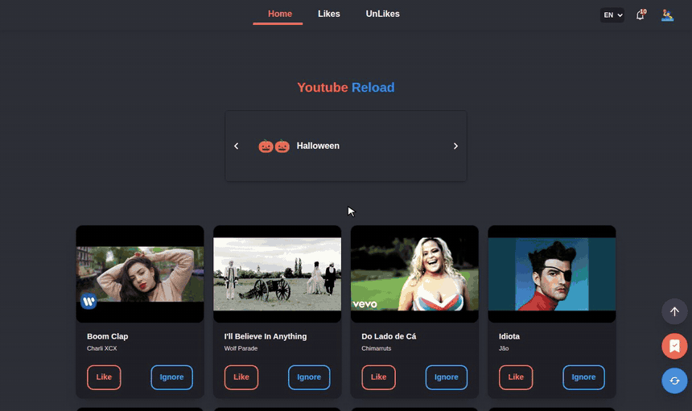

<div align="center">

# 🎵 Youtube Reload

**Generate playlists with songs you have never heard, and keep the ones you like. No account, no server, nothing to install.**

[**See it live »**](https://gabrielogregorio.github.io/youtube-reload/) · [Storybook](https://gabrielogregorio.github.io/youtube-reload/storybook/) · [Coverage](https://gabrielogregorio.github.io/youtube-reload/coverage/)


[](https://github.com/gabrielogregorio/youtube-reload/actions/workflows/tests.yml)
[](https://github.com/gabrielogregorio/youtube-reload/actions/workflows/check-quality.yml)
[](https://github.com/gabrielogregorio/youtube-reload/actions/workflows/codeql-analysis.yml)



</div>

## About

Each visit shuffles a catalog of songs into a new playlist of 25 cards. Every card opens the song on YouTube, and
**Like** or **Ignore** files it under the Likes or UnLikes screen.

- **Daily highlight:** commemorative dates and a random quote, with arrows to go through them.
- **Notifications:** what is new in the app, marked as read a few seconds after opening the bell.
- **Two languages:** English and Brazilian Portuguese, switched live from the top bar.
- **Your data stays with you:** reactions, profile emoji and language live in the browser `localStorage`.
- **Installable:** it is a PWA and keeps working offline after the first visit.

## Set up on a new PC

1. Install [nvm](https://github.com/nvm-sh/nvm), Node 24 and Corepack (which brings the pnpm version from
   `package.json`). The E2E tests also need Google Chrome:

   ```bash
   nvm install 24
   corepack enable
   ```

2. Clone and install:

   ```bash
   git clone https://github.com/gabrielogregorio/youtube-reload.git
   cd youtube-reload
   nvm use
   pnpm install
   ```

3. Check it and run it on <http://localhost:5173/youtube-reload/>:

   ```bash
   pnpm run unit:coverage
   pnpm run dev
   ```

Nothing lives outside the repository. In production, `SENTRY_AUTH_TOKEN` and `SENTRY_DSN` come from the `sentry`
environment of the GitHub repository; without them the app simply runs without Sentry.

## Scripts

| Command | What it does |
|---|---|
| `pnpm run dev` | Development server |
| `pnpm run build` | Production build in `build/` |
| `pnpm run preview` | Serves the production build |
| `pnpm run unit` | Unit tests in watch mode |
| `pnpm run unit:coverage` | Unit tests once; fails below 100% coverage |
| `pnpm run e2e` | Builds, then runs every Cypress spec and Lighthouse |
| `pnpm run e2e:ui` | Opens Cypress against the development server |
| `pnpm run e2e:lighthouse` | Lighthouse only, over an existing build |
| `pnpm run lint` | ESLint and TypeScript, Cypress included |
| `pnpm run lint:fix` | ESLint with automatic fixes |
| `pnpm run format` | Prettier |
| `pnpm run check:all` | Everything the CI runs on the code |
| `pnpm run storybook` | Component stories on port 6006 |

## Languages

English is both the source text and the key, and `src/core/i18n/locales/ptBR.ts` maps it to Brazilian Portuguese.
A missing translation falls back to English, and a unit test fails when any `t('…')` or data text has no `pt-BR` line.

The language comes from `?lang=pt-BR` in the URL, then the saved choice, then the browser language, then English.

```tsx
const { t } = useTranslation();

<button>{t('Generate Playlist')}</button>;
<button aria-label={t('Open notifications, {count} new', { count: 3 })} />;
```

To add a language: add it to `LanguageEnum` and `LANGUAGES` in `src/core/i18n/index.ts`, create its dictionary in
`locales/` and teach `normalizeLanguage` its tag. Song titles and artists are data and stay as published.

## Tests

- **Unit (Vitest + Testing Library):** 100% of lines, branches, functions and statements, enforced by thresholds in
  `vite.config.mts`. Only `src/index.tsx`, the stories and the test providers are out of the count.
- **E2E (Cypress + Cucumber):** the production build, with commemorative dates on a mocked clock, notifications,
  language switching and a guard against Tailwind losing its spacing. The specs fix the browser language and turn the
  service worker off, otherwise the machine locale and the PWA cache change the result.
- **Accessibility:** axe on every screen and at six viewport sizes. Notes in [docs/accessibility.md](docs/accessibility.md).
- **Lighthouse:** `scripts/lighthouse.mjs` requires at least 90 in accessibility, best practices and SEO.

## CI/CD

| Workflow | When | What |
|---|---|---|
| `tests.yml` | push and PR to `main` and `dev` | Unit, then E2E; a push to `main` then deploys the app, the Storybook and the coverage report to GitHub Pages |
| `check-quality.yml` | push and PR to `main` and `dev` | Lint, types, Prettier, `pnpm audit`, actions pinned to a hash |
| `codeql-analysis.yml` | push and PR to `main`, weekly | CodeQL on the code and on the workflows |
| `deploy-preview.yml` | PR | Publishes the app and the Storybook of the branch and links them on the PR |
| `auto-complete-fields.yml` | PR to `main` | Checks the version is new, assigns, labels and fills the changelog |
| `create-tag-and-release.yml` | PR merged into `main` | Creates the tag `vX.Y.Z` from `package.json` and the release |

Dependabot updates the npm packages and the actions monthly. Dependency rules and accepted risks are in
[docs/security.md](docs/security.md).

## License

[The Unlicense](LICENSE): public domain.
